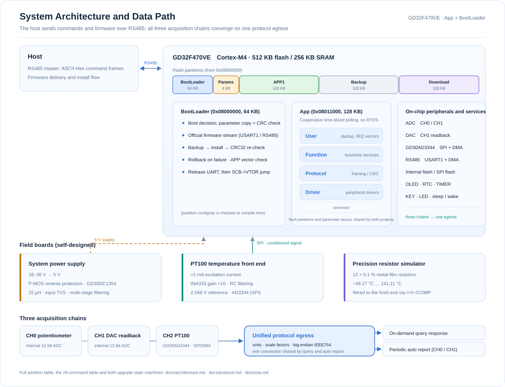
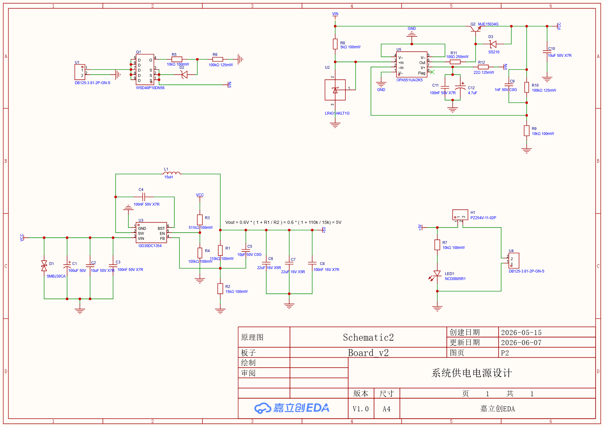
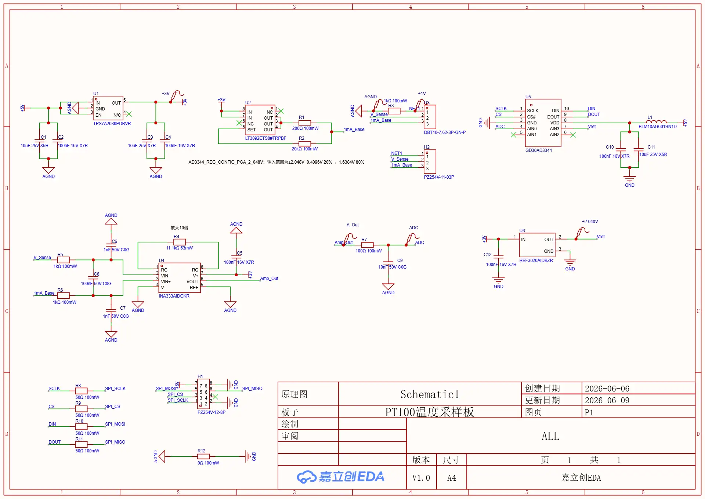
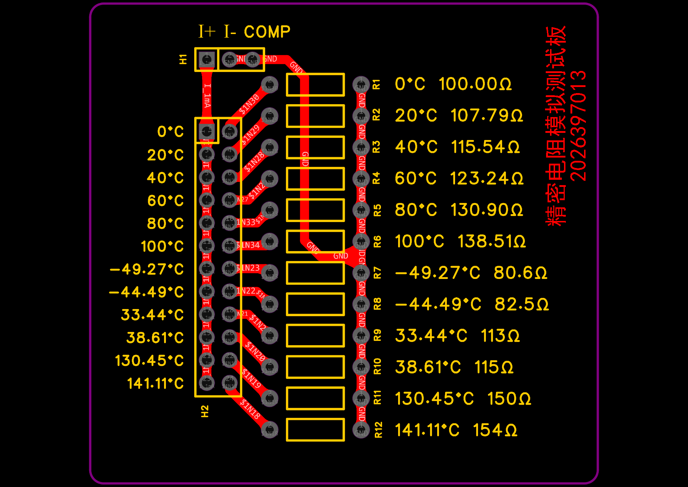
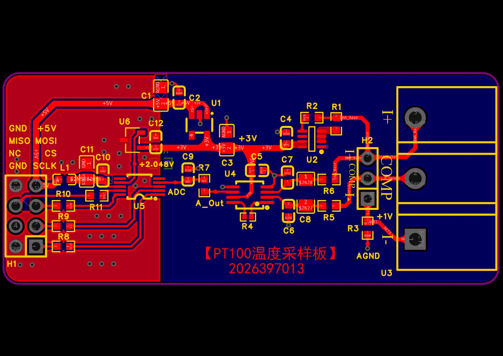
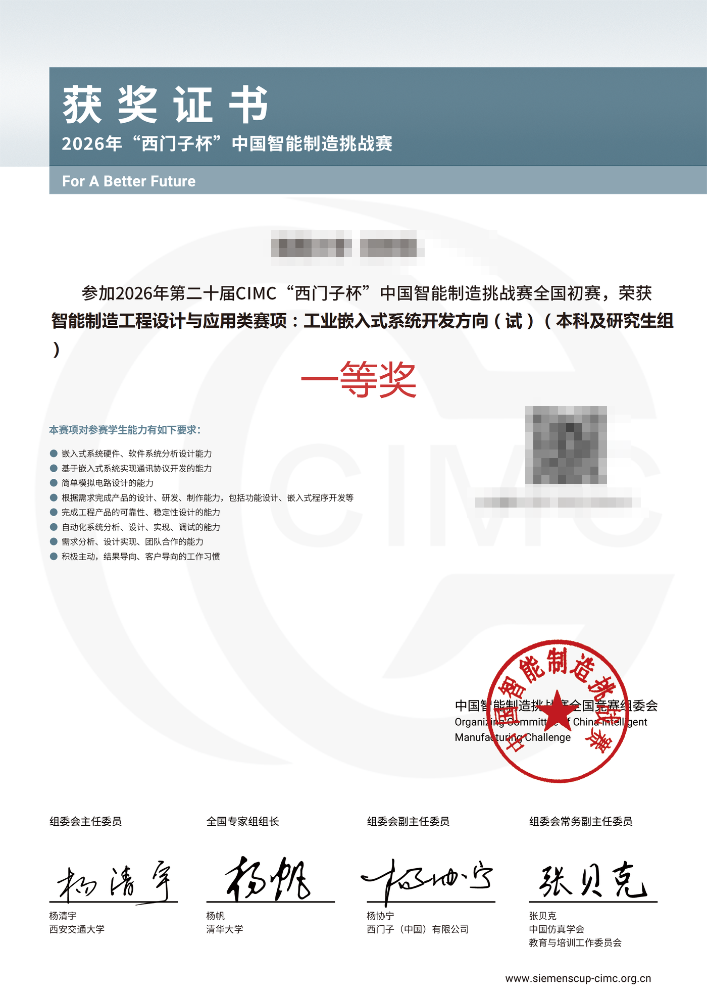

<div align="center">

# CIMC-Industrial-Embedded-2026

**Industrial Multi-Channel Data Acquisition and Remote Upgrade Terminal**

GD32F470VE · Bare-metal C · RS485 protocol stack · BootLoader and OTA

<sub>2026, 20th CIMC "Siemens Cup" China Intelligent Manufacturing Challenge</sub>
<sub>National Preliminary Round · First Prize · Stopped at the preliminaries</sub>

<p align="right"><a href="./README.md">中文</a> &nbsp; / &nbsp; <strong>English</strong></p>

</div>

---

## Stopping at the Preliminaries

In August 2026, when the first-prize list from the preliminaries came out, my board had already been quiet for two months.

The last line of code was written on 6 June. That night the serial log kept printing the same sequence: packet received, CRC32 re-checked, `SCB->VTOR` jump, and then the App was running again. The board had installed the new firmware by itself; all I did was press reset. Later the finals notice arrived, and it was in Beijing.

Then came the finals registration confirmation. Travel to Beijing, accommodation, and board during the competition all had to be paid upfront, and the sum of transport and lodging was not an amount I could wave away. I stayed on that confirmation page for a long time, and in the end I did not click.

So the story stops at "National Preliminary Round — First Prize". There are no photographs from the finals venue, no group shot on the awards stage — only a board with flying leads soldered onto it, a stack of serial logs, and this repository.

The regret is real. But what was written between April and June 2026 is real too: frame formats, CRC, the partition table, backup and rollback, transmit/receive timing, power-loss persistence… those are the only parts of that competition that did not disappear when I gave it up.

Cleaning them up and leaving them here is my way of settling accounts with that summer.

> If any of it is even slightly useful to you — whether you are preparing for a competition yourself, or just want to see how an industrial acquisition node turns from a problem statement into firmware that runs — read on. The parts I did not do well are all in "Known Limitations" below, and corrections are welcome.

---

## What This Is

A GD32F470VE development board plus three boards I designed myself, forming an industrial field acquisition node: wide-voltage supply, weak analog signal acquisition, RS485 network response, power-loss-safe parameter storage, and remote firmware upgrade.

| Item | Description |
| --- | --- |
| Competition | 2026, 20th CIMC "Siemens Cup" China Intelligent Manufacturing Challenge · Intelligent Manufacturing Engineering Design and Application track: Industrial Embedded System Development (undergraduate and graduate group) |
| Result | National Preliminary Round, **First Prize** (announced 2026.08; stopped at the preliminaries and did not attend the finals in Beijing) |
| Period | 2026.04 – 2026.06 |
| My role | Full design and implementation of the software (App + BootLoader); on the hardware side, proposed the key design ideas, led interface definition, and drove hardware/software integration |
| Target platform | GD32F470VE (Cortex-M4, 512 KB Flash / 256 KB SRAM), Keil MDK 5 |
| Code written by me | About 15,200 lines of C (App 11,364 lines / 85 files, BootLoader 3,848 lines / 28 files), excluding the vendor peripheral library kept in the projects |
| Firmware version | App `2.0.1.0` |
| Verification | CRC16-Modbus at frame level, CRC32 over the firmware image |

---

## System Overview

<div align="center">
  <picture>
    <source media="(prefers-color-scheme: dark)" srcset="assets/architecture-en-dark.svg">
    
  </picture>
</div>

The three sampling chains converge on a single protocol egress (`Rs485_Service_GetChannelValue`); one-shot queries and automatic reports reuse the same conversion and encoding logic, so that "the conversion is not written twice in two places".

---

## Features and Implementation

| Subsystem | Implementation notes | Main sources |
| --- | --- | --- |
| Task scheduling | Cooperative time-slice polling without an RTOS: 12 tasks assigned 10 / 20 / 50 / 200 / 1000 ms periods according to their response needs, due when `(now - last) >= period`, with uint32_t subtraction wrapping naturally | `CIMC_App/Function/Function.c` |
| RS485 communication | USART1 + DMA for transmit and receive; the IDLE interrupt takes the frame from the remaining counter; before transmitting it clears TC, waits for the DMA FTF and the USART TC, and only then releases DE, so the last byte is not truncated | `CIMC_App/Driver/RS485/rs485_dma.c` |
| Protocol stack | ASCII-Hex transport + binary frames (header/tail, device ID, frame type, command word, length, version, CRC16); case-insensitive, rejects odd lengths and illegal characters; three response classes: OK / ERROR / content frames | `CIMC_App/Protocol/cimc_protocol.c` |
| Command dispatch | Divided into six groups, `0x01xx`–`0x06xx`, 29 commands in total: system management, service parameters, data plane and auto report, channel scale factors and thresholds, firmware upgrade, alerts and status | `CIMC_App/Function/Rs485_service.c` |
| Data acquisition | CH0/CH1: internal ADC with an eight-point moving average, converted as `raw×3300/4095` and then multiplied by the scale factor; CH2 is read from the GD30AD3344 over SPI/DMA and converted to resistance as `V = raw×2.048/32768`, `R = V/(G·I)` | `Adc_service.c`, `Gd30ad3344_service.c` |
| Parameter persistence | Device ID, baud rate, report period, alert mode, the three scale factors, thresholds, raw DAC value, and alert records are written to Flash; CRC check + primary/backup copies + restore to defaults | `App_param_service.c`, `Alert_service.c`, `Driver/InternalFlash` |
| Automatic report | A state machine reports on 1 / 3 / 5 s periods; while reporting, as the competition required, it answers only the stop command; once stopped it returns to standby | `AutoReport_service.c` |
| Sleep and indication | Sleep / wake services, OLED status page, LED status indication, RTC time keeping | `Sleep_service.c`, `Oled_service.c`, `Rtc_service.c` |
| Firmware upgrade | On the App side: receives the firmware stream into a 32 KiB ring buffer, writes it in 512 B blocks into the download cache area, verifies the whole image with CRC32, then commits the upgrade parameters and resets. On the BootLoader side: checks the parameters and the vector table, backs up the current App, copies and installs, rolls back on failure, releases the serial resources, and jumps via `SCB->VTOR` | `BootUpdate_service.c`, `CIMC_BootLoader/Function/bl_core.c` |
| Protocol and tooling | OTA packet header construction and packaging script, for the host PC to deliver the image | `CIMC_App/Tools/ota_stream_pack.py` |
| Verification | 16 PowerShell assertion scripts + a manual verification checklist, delivered with the project | `tools/`, `docs/verification/` |

**On scheduling:** this cooperative polling pattern — a task table plus `(now - last) >= period` with wrap-safe subtraction — is not a one-off. The same pattern is packaged as a reusable template in [STM32 Polled Scheduler](https://github.com/Caden-1224/stm32-polled-scheduler) (STM32F407 + HAL, scheduler in `APP/polled_scheduler.c`). The task struct, the due check and the timestamp update correspond one to one; the differences are the time source and the task granularity — here 12 tasks with `get_millis()` read once per loop pass, there 4 tasks with `HAL_GetTick()` read per task. Comparison table in section 4.5 of [docs/architecture.md](docs/architecture.md).

More detail is in the documentation section (see "Documentation" below): the protocol frame format, the command table, the Flash partitions, and the state machines of both upgrade paths are all there.

---

## Hardware

The three boards are not meant to look good; each one solves a specific field problem.

| Board | Problem it solves | Key design |
| --- | --- | --- |
| System power supply | 18–36 V wide input, reverse polarity, and surges in an industrial setting | P-channel MOSFET (`WSD40P10DN56`) for reverse-polarity protection; `GD30DC1354` steps down to 5 V (15 µH inductor, `Vout = 0.6×(1+110k/15k)`); input TVS `SMBJ30CA`; multiple filter stages at input and output; output current-measurement header and status LED |
| PT100 temperature sampling board | Millivolt-level weak differential signals, mains-frequency and digital noise | About 1 mA constant-current excitation (`LT3092ETS8`); `INA333AIDGKR` instrumentation amplifier at gain 10; `REF3020AIDBZR` provides the 2.048 V reference; `AD3344` 24-bit Σ-Δ ADC communicates with the MCU over SPI; ferrite beads + RC filtering; single-point 0 Ω connection between AGND and GND |
| Precision resistor simulator board | How to verify sampling accuracy when there is no standard temperature source | 12 metal-film resistors of 0.1% / 25 ppm covering the resistances for −49.27 °C to 141.11 °C, range selected by jumpers, connected to the sampling board through the three-wire I+ / I− / COMP interface |

| System power supply (schematic) | PT100 temperature sampling board (schematic) |
| --- | --- |
|  |  |

| Precision resistor simulator board (PCB) | PT100 temperature sampling board (PCB) |
| --- | --- |
|  |  |

The schematic and PCB source files (JLC EDA Professional projects) are in [`hardware/`](hardware/), and the full design notes are in [docs/hardware.md](docs/hardware.md).

---

## Repository Structure

```
CIMC-Industrial-Embedded-2026/
├── CIMC_App/                 # App firmware (Keil MDK project)
│   ├── Driver/               # Register-level peripheral drivers: ADC / DAC / GD30AD3344 / RS485 / USART / Timer / Flash / OLED / RTC / KEY / LED
│   ├── Function/             # Service layer: scheduling, protocol dispatch, sampling, reporting, alerts, sleep, upgrade reception, parameter persistence
│   ├── Protocol/             # Frame codec, CRC16 / CRC32, OTA packet header
│   ├── common/               # Flash partition and parameter layout definitions shared by App and BootLoader
│   ├── Components/ User/ Startup/ CMSIS/ Library/   # components, startup and interrupts, core headers, vendor peripheral library
│   ├── Tools/                # OTA packaging script
│   └── project/              # Keil project, EIDE project, OTA packaging batch file
├── CIMC_BootLoader/          # BootLoader firmware (separate Keil project, layered the same way as Driver / Function / Protocol / common)
├── docs/                     # Documentation: architecture, protocol, OTA, hardware, verification, development log, manual checklist
├── hardware/                 # Hardware: JLC EDA project archives + schematic / PCB renders
├── tools/                    # PowerShell verification scripts
├── README.md / README.en.md
└── LICENSE
```

---

## Documentation

| Document | Contents |
| --- | --- |
| [docs/architecture.md](docs/architecture.md) | System layering, task schedule and its semantics, boot flow, three-channel data paths, module list |
| [docs/protocol.md](docs/protocol.md) | Byte-by-byte frame format tables, CRC parameters and coverage, complete command table, message examples, protocol boundaries |
| [docs/ota.md](docs/ota.md) | Flash partition table, state machines of both upgrade paths, install/backup/rollback, jump sequence, and known gaps |
| [docs/hardware.md](docs/hardware.md) | Design goals of the three boards, component selection, layout and grounding, signal-chain calculations, measurements still to be added |
| [docs/verification.md](docs/verification.md) | Verification strategy, list of the 17 assertion scripts, how to use the manual checklist, uncovered items |
| [docs/hardware-pinout.md](docs/hardware-pinout.md) | Suggested pin assignment for the GD32F470 development board |
| [docs/verification/](docs/verification/) | Manual RS485 and protocol verification checklists |
| [docs/contest/](docs/contest/) | Original problem statement (copyright belongs to the organizers; cited here only as background) |

---

## Building and Flashing

**Environment**: Keil MDK 5 (ARMCC) + GigaDevice GD32F4xx device support pack; or VSCode + EIDE (the project is in `CIMC_App/project/eide/`); the OTA packaging script needs Python 3.

**The two projects are built separately** (note that their link addresses differ and they are not interchangeable):

| Project | Entry address | Size limit | Keil project file |
| --- | --- | --- | --- |
| BootLoader | `0x08000000` | 64 KB | `CIMC_BootLoader/project/CIMC_BootLoader.uvprojx` |
| App | `0x08011000` | 128 KB | `CIMC_App/project/CIMC_App.uvprojx` |

**Flashing order**: flash the BootLoader first, then the App. The App and BootLoader share the partition definitions under `common/`, and the partition table carries compile-time assertions (adjacency, capacity, bounds), so changing a partition fails the build immediately.

**Build status**: on 2026-10-03 both projects were **fully rebuilt** with Keil MDK V5.41 (ARMCC V5.06u7), each finishing with `0 Error(s), 0 Warning(s)` — BootLoader `Code=10614`, App `Code=31326`, byte-identical to the last build before the final commit on 2026-06-06. The OTA packaging script produced `CIMC_App_ota.bin` (39.2 KB) in the same run. This only shows the sources are accepted by the toolchain; functional and hardware behaviour is still governed by "Known Limitations" below. Record: section 1.3 of [docs/verification.md](docs/verification.md).

The partitions sit in Flash as follows: BootLoader at `0x08000000` (64 KB), the parameter page at `0x08010000`, App at `0x08011000` (128 KB), the App backup at `0x08031000`, and the download cache at `0x08051000`. The full partition table is in [docs/ota.md](docs/ota.md).

**Packaging an OTA image** (requires `CIMC_App/project/Objects/CIMC_App.bin` to be built first):

```bat
cd CIMC_App\project
make_ota_package.bat
```

The output is `Objects/CIMC_App_ota.bin` (packet header + raw App firmware; the convention is in [docs/ota.md](docs/ota.md)).

**Running the verification scripts** (the scripts locate the project root from their own path; Windows PowerShell is used below — with PowerShell 7 installed, substitute `pwsh`):

```powershell
powershell -File tools/verify_t13_bootloader_install.ps1
powershell -File tools/verify_n03_bootloader_app_handoff.ps1
```

---

## Known Limitations

I wrote this section in concrete terms, because what is most worth describing in a project is often not the part that is finished.

- **USART0 streaming OTA is not closed-loop**: the App side can receive the stream, verify CRC32, write the download area, and set a PENDING state, but the BootLoader currently handles only the `FAST_UPGRADE` and `DOWNLOADED` entries. The PENDING branch is missing, so this path cannot yet install end to end.
- **No full power-loss regression**: the combinations of power loss during backup, erase, copy, and parameter commit have not been verified point by point, so I cannot claim that "any power loss is recoverable".
- **No signature and no anti-rollback**: CRC32 detects errors only; it provides no authenticity. Image signing, secure boot, and version anti-rollback are future work.
- **Several hard boundaries in the driver and protocol layers**: the RS485 transmit wait for FTF/TC has no timeout; reception has only a single frame buffer, with no multi-frame queue; the effect of overlong gapless input and of flash erase/write stalls has not been stress-tested.
- **CH2 outputs resistance only**: the chain ends at the resistance conversion; the conversion from PT100 resistance to temperature is not implemented yet, and automatic reports also cover only CH0/CH1 plus a timestamp.
- **Sample validity is not checked at the protocol egress**: a failed GD30AD3344 read clears the ready flag, but the protocol egress does not check ready, so on a fault an old value can be answered as a new one.
- **Parameter primary and backup are erased on the same page**: the primary and backup parameter copies live in the same 4 KiB page, so a power loss during erase risks invalidating both at once; nor is there a read-back check after flash writes.
- **Gaps on the hardware side**: the loaded and temperature-rise test report, ripple and efficiency measurements, EMC / surge verification, schematic PDF export, BOM, and photographs of the assembled boards have not been put together yet.

---

## Award

<div align="left">



</div>

The name, school, certificate number, and QR code on the certificate have been masked; the original is provided to recruiters only when needed. For competition details, refer to the organizer's official website.

---

## License and Notices

- The code written for this repository (the parts of `CIMC_App` and `CIMC_BootLoader` other than the vendor libraries, plus `tools/` and `docs/`) is released under the [MIT](LICENSE) license.
- The GigaDevice peripheral and USB libraries and the ARM CMSIS headers under `CIMC_App/Library`, `CIMC_BootLoader/Library`, and `CMSIS/` are copyright their respective owners; they are kept in the projects only so that the code builds directly. Follow their original licenses.
- The copyright of the problem statement under `docs/contest/` belongs to the competition organizers; it is cited here only as project background and does not constitute a sublicense.
- The schematics and PCBs under `hardware/` were drawn by this team and are shared with the repository for study and reference.
- Anything marked "to be confirmed", "not done", or "not verified" in the documentation means that no corresponding evidence was obtained while preparing this repository; it does not mean the item is implemented.

---

<div align="center">

If this repository is useful to you, or if you are also working in industrial embedded systems, I would be glad to hear from you.

[GitHub](https://github.com/Caden-1224) · [Email](mailto:seekercaden@outlook.com)

</div>
