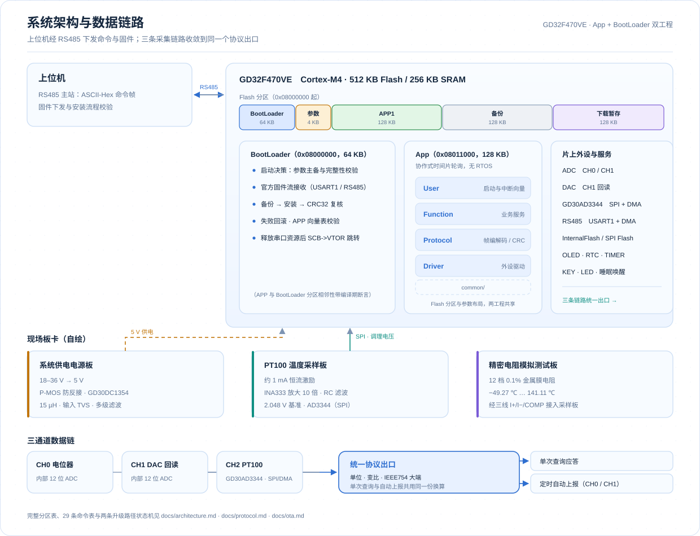
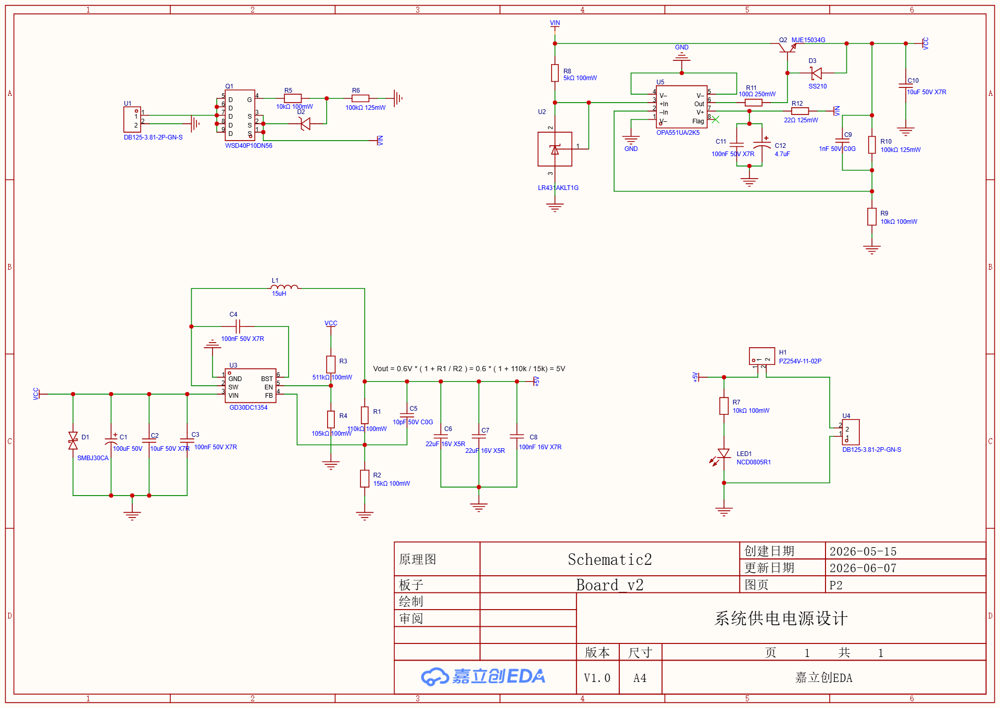
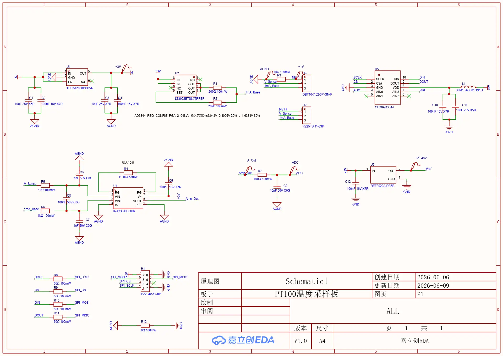
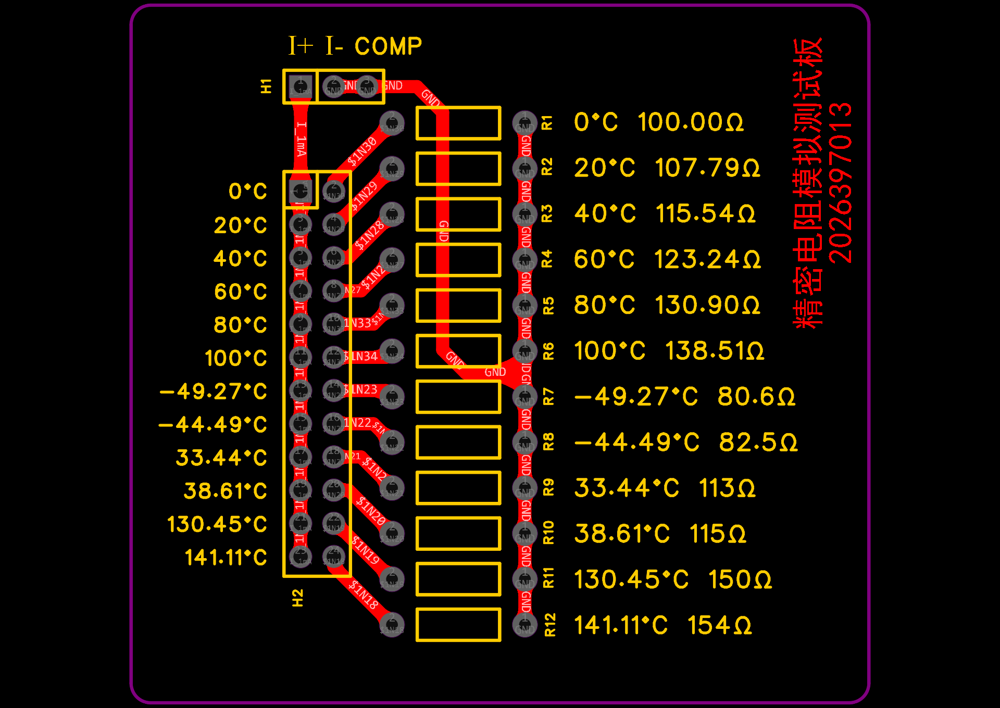
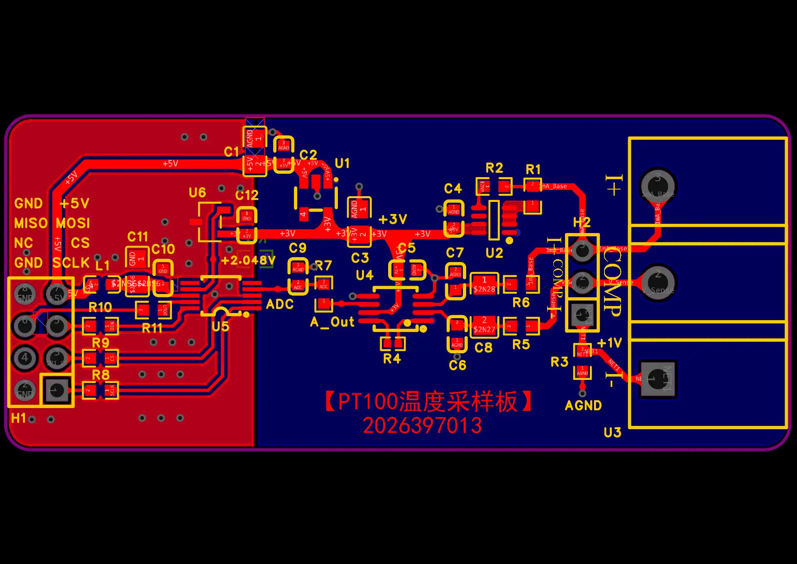
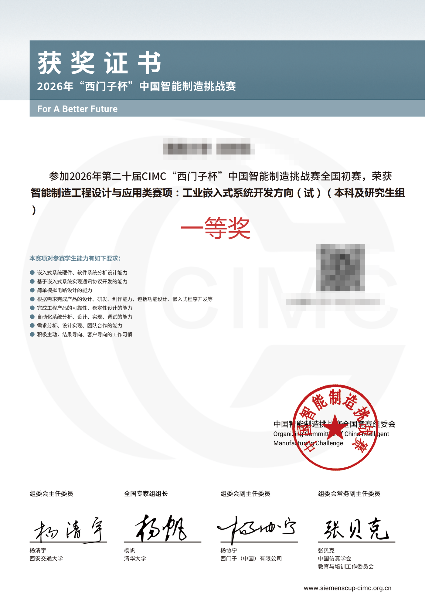

<div align="center">

# CIMC-Industrial-Embedded-2026

**工业多通道数据采集与远程升级终端**

GD32F470VE · 裸机 C · RS485 协议栈 · BootLoader 与 OTA

<sub>2026 年第二十届 CIMC「西门子杯」中国智能制造挑战赛</sub>
<sub>全国初赛 · 一等奖 · 止步于初赛</sub>

</div>

<p align="right"><strong>中文</strong> &nbsp; / &nbsp; <a href="./README.en.md">English</a></p>

---

## 止步初赛

2026 年 8 月，初赛一等奖的名单出来时，我的板子已经安静了两个月。

最后一行代码停在 6 月 6 日。那天夜里串口反复打印同一串流程：收包、CRC32 复核、`SCB->VTOR` 跳转，然后 App 又跑起来了。新固件是它自己装进去的，我只按了一次复位。再后来，决赛通知下来了，地点在北京。

然后是决赛报名确认。去北京的路费、住宿和赛期食宿要先自己垫上，交通加住宿加起来不是一笔可以随手划掉的数目。我在那张确认页上停留了很久，最后没有点下去。

所以这个故事停在「全国初赛一等奖」。没有决赛现场的照片，没有颁奖台上的合影，只有一块焊着飞线的板子、一沓串口日志，和这个仓库。

遗憾是真的。但 2026 年 4 月到 6 月里写下的东西也是真的：帧格式、CRC、分区表、备份与回滚、收发时序、掉电保存……它们是那次比赛里唯一没有因为我的放弃而消失的部分。

把它们整理干净、放在这里，算是给那个夏天一个交代。

> 如果它对你有一点点用——无论你也在准备比赛，还是只想看看一个工业采集节点怎么从赛题变成能跑的固件——下面都可以读。做得不够好的地方都写在下面的「已知边界」里，欢迎指正。

---

## 这是什么

一颗 GD32F470VE 的开发板，加上三块自己画的板子，构成的一个工业现场采集节点：宽压供电、微弱模拟信号采集、RS485 联网应答、参数掉电保存、以及远程固件升级。

| 项目 | 说明 |
| --- | --- |
| 赛事 | 2026 年第二十届 CIMC「西门子杯」中国智能制造挑战赛 · 智能制造工程设计与应用类赛项：工业嵌入式系统开发方向（本科及研究生组） |
| 成绩 | 全国初赛 **一等奖**（2026.08 公布；初赛即止步，未参加北京总决赛） |
| 时间 | 2026.04 – 2026.06 |
| 我的角色 | 软件（App + BootLoader）全程设计与实现；硬件侧提出关键设计思路、主导接口定义与软硬件联调 |
| 目标平台 | GD32F470VE（Cortex-M4，512 KB Flash / 256 KB SRAM），Keil MDK 5 |
| 自研代码 | 约 15,200 行 C（App 11,364 行 / 85 个文件，BootLoader 3,848 行 / 28 个文件），不含随工程保留的厂商外设库 |
| 固件版本 | App `2.0.1.0` |
| 校验方式 | 帧级 CRC16-Modbus，固件镜像 CRC32 |

---

## 系统概览

<div align="center">
  <picture>
    <source media="(prefers-color-scheme: dark)" srcset="assets/architecture-zh-dark.svg">
    
  </picture>
</div>

三条采样链路收敛到同一个协议出口（`Rs485_Service_GetChannelValue`），单次查询与自动上报复用同一份换算与编码逻辑，避免"两个地方各写一遍换算"。

---

## 功能与实现

| 子系统 | 实现要点 | 主要源码 |
| --- | --- | --- |
| 任务调度 | 无 RTOS 的协作式时间片轮询：12 个任务按响应需求分配 10 / 20 / 50 / 200 / 1000 ms 周期，`(now - last) >= period` 判断到期，uint32_t 差值天然抗回绕 | `CIMC_App/Function/Function.c` |
| RS485 通信 | USART1 + DMA 收发；IDLE 中断按剩余计数取帧；发送前清 TC、等 DMA FTF 与 USART TC 后再释放 DE，避免末尾字节被截断 | `CIMC_App/Driver/RS485/rs485_dma.c` |
| 协议栈 | ASCII-Hex 传输 + 二进制帧（帧头/帧尾、设备 ID、帧类型、命令字、长度、版本、CRC16）；大小写兼容、拒绝奇数长度与非法字符；OK / ERROR / 内容帧三类应答 | `CIMC_App/Protocol/cimc_protocol.c` |
| 命令分派 | 按 `0x01xx`–`0x06xx` 六组划分共 29 条命令：系统管理、业务参数、数据面与自动上报、通道变比与阈值、固件升级、告警与状态 | `CIMC_App/Function/Rs485_service.c` |
| 数据采集 | CH0/CH1 内部 ADC 八点滑动平均 + `raw×3300/4095` 换算后乘变比；CH2 由 GD30AD3344 经 SPI/DMA 读取，按 `V = raw×2.048/32768`、`R = V/(G·I)` 换算为电阻 | `Adc_service.c`、`Gd30ad3344_service.c` |
| 参数持久化 | 设备 ID、波特率、上报周期、告警模式、三路变比、阈值、DAC 原始值与告警记录写入 Flash；CRC 校验 + 主备副本 + 默认恢复 | `App_param_service.c`、`Alert_service.c`、`Driver/InternalFlash` |
| 自动上报 | 状态机按 1 / 3 / 5 s 周期主动上报；上报期间按赛题要求只响应停止命令；被停止后回到待命 | `AutoReport_service.c` |
| 睡眠与指示 | 睡眠 / 唤醒服务、OLED 状态页、LED 状态指示、RTC 时间维护 | `Sleep_service.c`、`Oled_service.c`、`Rtc_service.c` |
| 固件升级 | App 侧 32 KiB 环形缓冲接收固件流、512 B 分块写入下载暂存区、整镜像 CRC32 校验后提交升级参数并复位；BootLoader 侧校验参数与向量表、备份当前 App、复制安装、失败回滚、释放串口资源后 `SCB->VTOR` 跳转 | `BootUpdate_service.c`、`CIMC_BootLoader/Function/bl_core.c` |
| 协议与工具 | OTA 包头构造与打包脚本，供上位机下发 | `CIMC_App/Tools/ota_stream_pack.py` |
| 验证 | 17 个 PowerShell 断言脚本 + 人工核验清单，随工程一起交付 | `tools/`、`docs/verification/` |

**关于调度**：这种「任务表 + `(now - last) >= period` + 差值抗回绕」的协作式轮询不是一次性的写法。同一套模式我也整理成了可复用模板 [STM32 Polled Scheduler](https://github.com/Caden-1224/stm32-polled-scheduler)（STM32F407 + HAL，调度器在 `APP/polled_scheduler.c`）。两边的任务结构体、到期判断与时间戳更新一一对应，差别只在时间源与任务粒度：本工程 12 项任务、每轮循环只取一次 `get_millis()`；模板 4 项、每个任务被检查时各取一次 `HAL_GetTick()`。对照表在 [docs/architecture.md](docs/architecture.md) 的 4.5 节。

更细的说明在文档区（见下方「文档」），协议帧格式、命令表、Flash 分区、两条升级路径的状态机都在里面。

---

## 硬件

三块板子不是为了好看，每一块都在解决一个具体的现场问题。

| 板卡 | 解决的问题 | 关键设计 |
| --- | --- | --- |
| 系统供电电源 | 工业现场 18–36 V 宽压输入、反接与浪涌 | P 沟道 MOS（`WSD40P10DN56`）防反接；`GD30DC1354` 降压至 5 V（15 μH 电感、`Vout = 0.6×(1+110k/15k)`）；输入 TVS `SMBJ30CA`；输入/输出多级滤波；输出测流接口与状态灯 |
| PT100 温度采样板 | 毫伏级微弱差分信号、工频与数字噪声 | 约 1 mA 恒流激励（`LT3092ETS8`）；`INA333AIDGKR` 仪表放大 10 倍；`REF3020AIDBZR` 提供 2.048 V 基准；`AD3344` 24 位 Σ-Δ ADC 经 SPI 与 MCU 通信；磁珠 + RC 滤波；0 Ω 单点连接 AGND/GND |
| 精密电阻模拟测试板 | 没有标准温度源时如何验证采样精度 | 12 颗 0.1% / 25 ppm 金属膜电阻覆盖 −49.27 ℃ 至 141.11 ℃ 对应阻值，跳线帽换挡，按 I+ / I− / COMP 三线接口接入采样板 |

| 系统供电电源（原理图） | PT100 温度采样板（原理图） |
| --- | --- |
|  |  |

| 精密电阻模拟测试板（PCB） | PT100 温度采样板（PCB） |
| --- | --- |
|  |  |

原理图与 PCB 源文件（嘉立创 EDA 专业版工程）在 [`hardware/`](hardware/)，完整设计说明见 [docs/hardware.md](docs/hardware.md)。

---

## 仓库结构

```
CIMC-Industrial-Embedded-2026/
├── CIMC_App/                 # App 固件（Keil MDK 工程）
│   ├── Driver/               # 寄存器级外设驱动：ADC / DAC / GD30AD3344 / RS485 / USART / Timer / Flash / OLED / RTC / KEY / LED
│   ├── Function/             # 业务服务：调度、协议分派、采样、上报、告警、睡眠、升级接收、参数持久化
│   ├── Protocol/             # 帧编解码、CRC16 / CRC32、OTA 包头
│   ├── common/               # App 与 BootLoader 共享的 Flash 分区与参数布局定义
│   ├── Components/ User/ Startup/ CMSIS/ Library/   # 组件、启动与中断、内核头、厂商外设库
│   ├── Tools/                # OTA 打包脚本
│   └── project/              # Keil 工程、EIDE 工程、OTA 打包批处理
├── CIMC_BootLoader/          # BootLoader 固件（独立 Keil 工程，同样按 Driver / Function / Protocol / common 分层）
├── docs/                     # 文档：架构、协议、OTA、硬件、验证、开发记录、人工核验清单
├── hardware/                 # 硬件：嘉立创 EDA 工程归档 + 原理图 / PCB 渲染图
├── tools/                    # PowerShell 验证脚本
├── README.md / README.en.md
└── LICENSE
```

---

## 文档

| 文档 | 内容 |
| --- | --- |
| [docs/architecture.md](docs/architecture.md) | 系统分层、任务调度表与语义、启动流程、三通道数据通路、模块清单 |
| [docs/protocol.md](docs/protocol.md) | 帧格式逐字节表、CRC 参数与覆盖范围、完整命令表、报文示例、协议边界 |
| [docs/ota.md](docs/ota.md) | Flash 分区表、两条升级路径的状态机、安装/备份/回滚、跳转序列与已知缺口 |
| [docs/hardware.md](docs/hardware.md) | 三块板的设计目标、器件选型、布局与接地、信号链核算、待补实测项 |
| [docs/verification.md](docs/verification.md) | 验证策略、17 个断言脚本清单、人工核验清单用法、未覆盖项 |
| [docs/hardware-pinout.md](docs/hardware-pinout.md) | GD32F470 开发板引脚分配建议 |
| [docs/verification/](docs/verification/) | RS485 与协议人工核验清单 |
| [docs/contest/](docs/contest/) | 赛题原文（版权归主办方，仅作题目背景引用） |

---

## 编译与烧录

**环境**：Keil MDK 5（ARMCC）+ GigaDevice GD32F4xx 器件支持包；或 VSCode + EIDE（工程在 `CIMC_App/project/eide/`）；OTA 打包脚本需要 Python 3。

**两个工程分别编译**（注意链接地址不同，不能互换）：

| 工程 | 入口地址 | 大小上限 | Keil 工程文件 |
| --- | --- | --- | --- |
| BootLoader | `0x08000000` | 64 KB | `CIMC_BootLoader/project/CIMC_BootLoader.uvprojx` |
| App | `0x08011000` | 128 KB | `CIMC_App/project/CIMC_App.uvprojx` |

**烧录顺序**：先烧 BootLoader，再烧 App。App 与 BootLoader 共享 `common/` 下的分区定义，分区表带编译期断言（相邻性、容量、越界），改分区会直接编译报错。

**构建状态**：2026-10-03 在 Keil MDK V5.41（ARMCC V5.06u7）下对两个工程各做了一次**全量重编译**，均为 `0 Error(s), 0 Warning(s)`——BootLoader `Code=10614`、App `Code=31326`，与 2026-06-06 最后一次提交前构建的字节数完全一致；同轮 OTA 打包脚本产出 `CIMC_App_ota.bin`（39.2 KB）。这里只说明源码能被工具链接受，功能与硬件行为仍以下面的「已知边界」为准，记录见 [docs/verification.md](docs/verification.md) 1.3 节。

**打包 OTA 镜像**（需要先编译出 `CIMC_App/project/Objects/CIMC_App.bin`）：

```bat
cd CIMC_App\project
make_ota_package.bat
```

产物为 `Objects/CIMC_App_ota.bin`（包头 + 原始 App 固件，约定见 [docs/ota.md](docs/ota.md)）。

**跑一遍验证脚本**（脚本会按自身位置自动定位工程根目录；下面用 Windows 自带的 Windows PowerShell，装有 PowerShell 7 的话把 `powershell` 换成 `pwsh` 即可）：

```powershell
powershell -File tools/verify_t13_bootloader_install.ps1
powershell -File tools/verify_n03_bootloader_app_handoff.ps1
```

---

## 已知边界

这一节我写得很具体，因为工程里最值得说的往往不是做完的部分。

- **USART0 流式 OTA 未闭环**：App 侧能收流、校验 CRC32、写下载区并落 PENDING 状态，但 BootLoader 当前只处理 `FAST_UPGRADE` 与 `DOWNLOADED` 两个入口，PENDING 分支缺失，这条路径还不能端到端安装。
- **掉电回归未做全覆盖**：备份、擦除、复制、参数提交各阶段断电的组合没有逐点验收，不能声称"任意掉电都可恢复"。
- **无签名与防回退**：CRC32 只能检错，不提供真实性；镜像签名、安全启动、版本防回退属于后续改造。
- **驱动与协议层的若干硬边界**：RS485 发送等待 FTF/TC 没有超时；接收只有单帧缓冲，无多帧队列；超长无间隙输入与 Flash 擦写停顿的影响未做压力测试。
- **CH2 只输出电阻**：链路止于电阻换算，尚未实现 PT100 电阻到温度的换算；自动上报也只包含 CH0/CH1 与时间戳。
- **采样有效性未在协议出口校验**：GD30AD3344 读取失败会清 ready 标志，但协议出口没有检查 ready，异常时可能把旧值当新值应答。
- **参数主备同页擦除**：主备参数副本位于同一 4 KiB 页内，擦除期间掉电存在两份同时失效的风险；Flash 写入也没有回读验证。
- **硬件侧缺口**：带载与温升实测报告、纹波与效率测量、EMC / 浪涌验证、原理图 PDF 导出、BOM 与实物照片尚未整理。

---

## 获奖

<div align="left">



</div>

证书上的姓名、学校、证书编号与二维码已做遮蔽处理；原件仅在需要时向招聘方提供。赛事信息以主办方官网为准。

---

## 许可与声明

- 本仓库自研代码（`CIMC_App`、`CIMC_BootLoader` 中除厂商库以外的部分、`tools/`、`docs/`）以 [MIT](LICENSE) 许可开源。
- `CIMC_App/Library`、`CIMC_BootLoader/Library`、`CMSIS/` 下的 GigaDevice 外设库、USB 库与 ARM CMSIS 头文件版权归各自所有者，随工程保留仅为保证可直接编译，请遵循其原始许可。
- `docs/contest/` 下的赛题原文版权归赛事主办方，此处仅作项目背景引用，不构成再授权。
- `hardware/` 下的原理图与 PCB 为本队自绘，随仓库供学习参考。
- 文档中标注为「待核实」「未做」「未验收」的内容，代表本次整理时未取得相应证据，不代表已实现。

---

<div align="center">

如果这个仓库对你有帮助，或者你也在做工业嵌入式方向，欢迎交流。

[GitHub](https://github.com/Caden-1224) · [Email](mailto:seekercaden@outlook.com)

</div>
