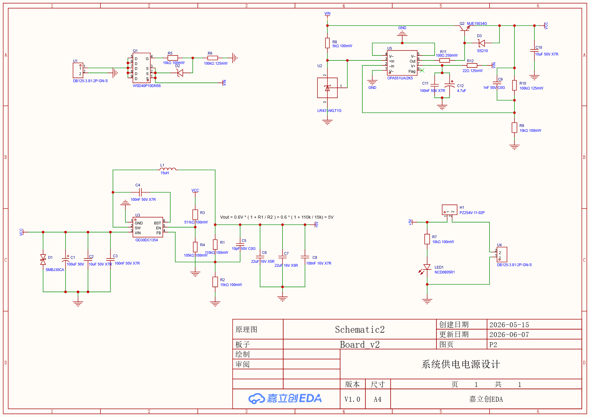
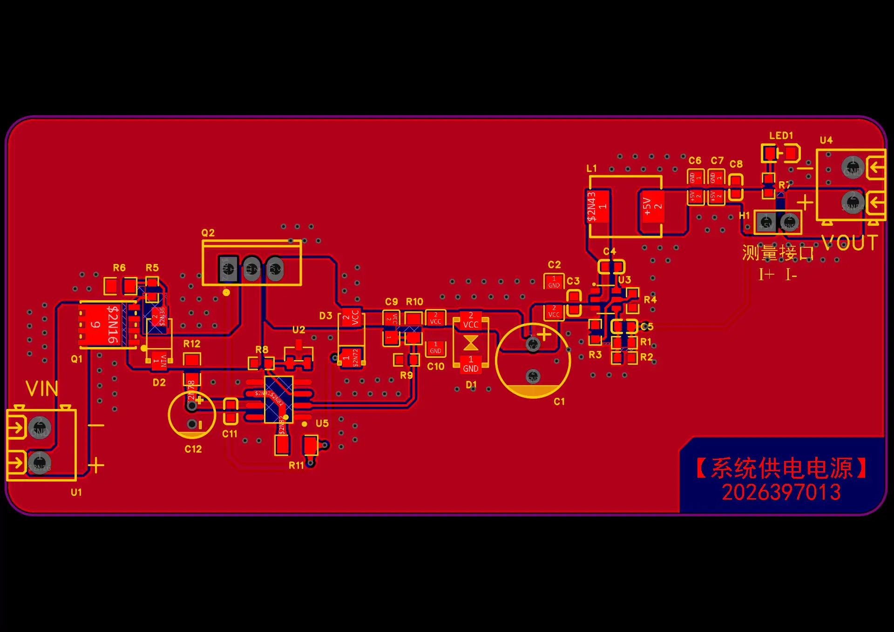
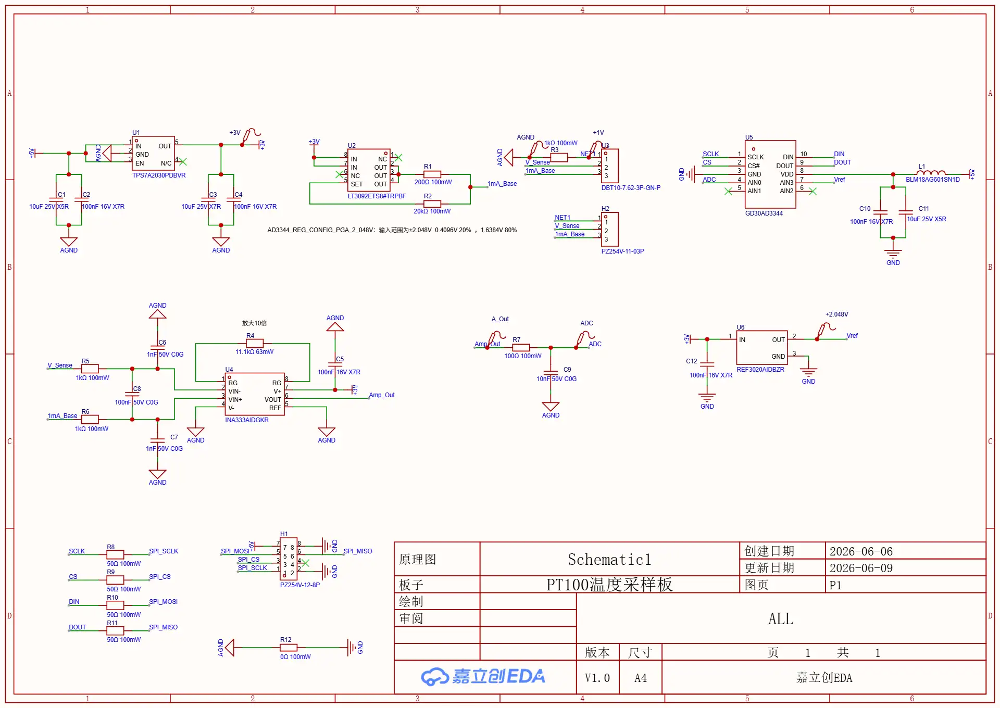
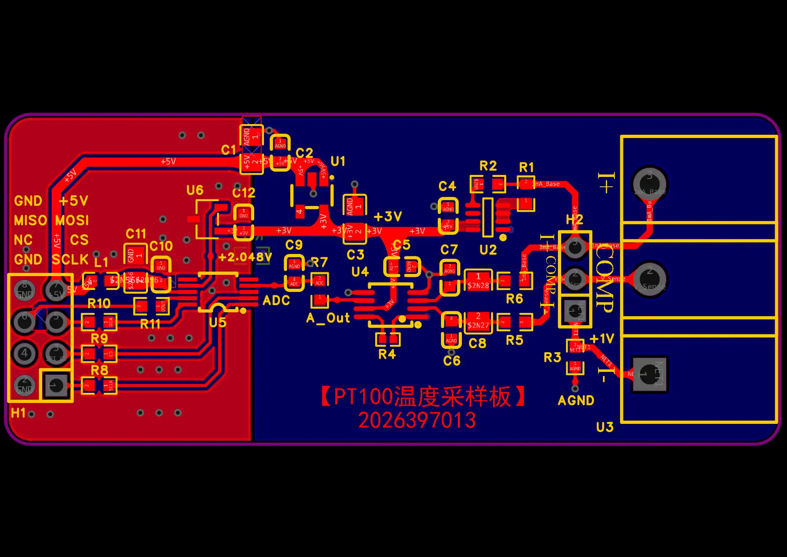
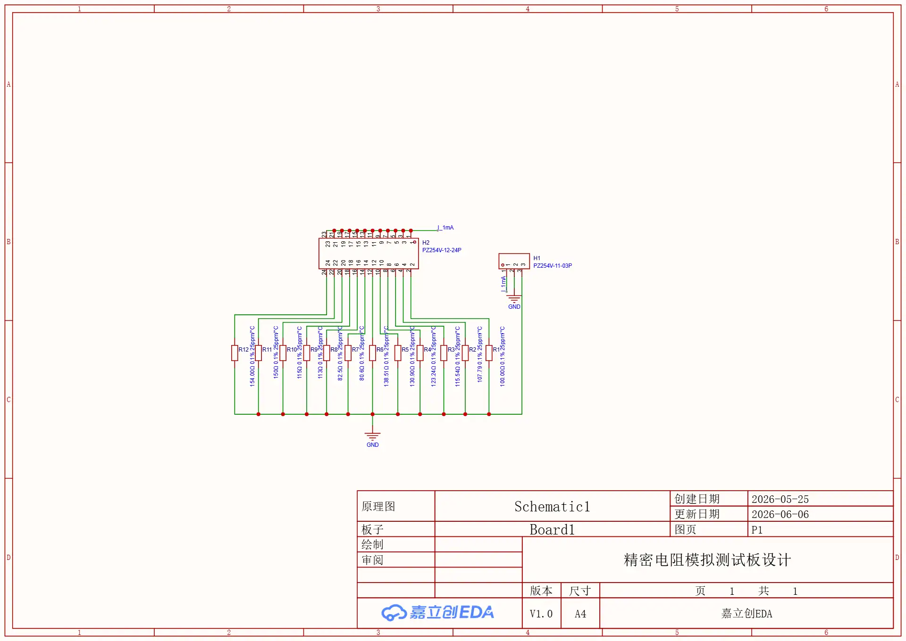
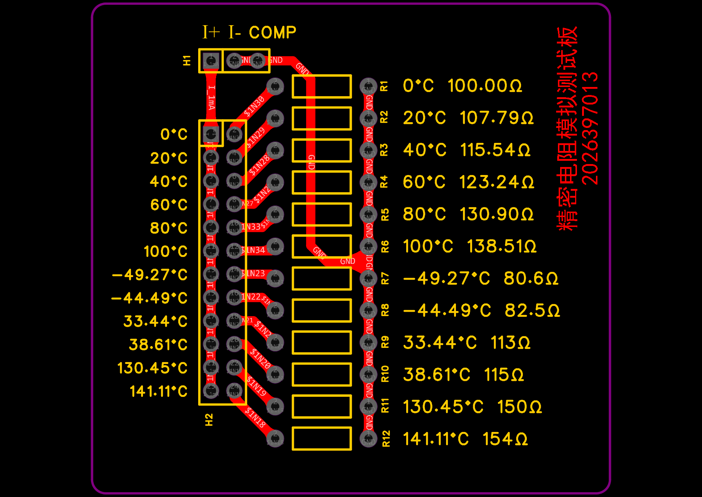

# 硬件设计

本文档说明本项目的硬件构成：一块厂商 `GD32F470` 开发板，加三块自行设计的板卡（系统供电电源板、PT100 温度采样板、精密电阻模拟测试板）。内容按"设计目标与约束 → 器件选型 → 原理图要点 → PCB 布局与分区 → 接口定义"组织，并给出信号链的量级核算与验证边界。

硬件资料的第一手出处为本仓库 `hardware/` 目录中的嘉立创 EDA 专业版工程归档与导出的渲染图。PCB 丝印中的 `2026397013` 为竞赛团队编号，文中引用的板卡图片均带此编号。

阅读约定：

- 文中所有器件位号、阻容值与型号均取自工程归档与渲染图。凡归档中未能直接读到、只能从渲染图推断的内容，均标注"待在实物/归档中复核"。
- 本文不含任何实测数据。效率、纹波、温升、噪声、温度精度等指标一律未做测量或未整理，不作为本文结论。

## 1. 总体构成

### 1.1 系统框图

```text
  18-36 V 工业输入
        |
        v
  +-------------------+        VCC / VIN 预稳压    +---------------------+
  |  系统供电电源板    | -------------------------> |  GD32F470 开发板     |
  |  P-MOS 防反接      |         5V (VOUT)         |  (MCU + 板载资源)    |
  |  GD30DC1354 降压   | <------------------------- |                      |
  +-------------------+    +5V 回馈(经 H1/H2)      +----------+----------+
                                                             |
                        +------------------------------------+
                        |  +5V / +3V / +2.048V / SPI3(4 线)
                        v
              +-------------------+     I+ / I- / COMP       +----------------------+
              | PT100 温度采样板   | <----------------------> | 精密电阻模拟测试板    |
              | 1 mA 恒流 + 仪放   |    (三线制接线)           | 12 档 0.1% 电阻换挡   |
              | AD3344 24 位 ADC  |                          | (代替真实温度源)      |
              +---------+---------+                          +----------------------+
                        | SPI3：SCLK / CS# / DIN / DOUT
                        v
                 GD32F470 (PE12/PE13/PE14 + PE10)
```

### 1.2 各板解决的问题

| 板卡 | 解决的问题 | 关键手段 |
|---|---|---|
| 系统供电电源板 | 工业现场输入电压跨度大（18–36 V）、极性可能接反、输入侧存在浪涌 | P 沟道 MOS 防反接、`GD30DC1354` 宽压降压到 5 V、输入 TVS、多级输出滤波 |
| PT100 温度采样板 | 铂电阻阻值变化小、信号为毫伏级、易受工频与数字噪声干扰 | 约 1 mA 恒流激励、三线制接线、仪表放大器差分放大、2.048 V 基准、模拟/数字分区与 0 Ω 单点连接 |
| 精密电阻模拟测试板 | 没有标准温度源时无法确认采样电链路与换算是否正确 | 12 颗 0.1%/25 ppm 金属膜电阻，用跳线帽换挡，覆盖 −49 °C 至 141 °C 对应阻值 |
| GD32F470 开发板 | 承载 MCU、通信、显示、存储与升级功能 | 厂商开发板，复用其板载 RS485 / 调试串口 / OLED / SPI Flash 等资源 |

### 1.3 板间连接关系

三块自研板卡与开发板之间靠排针/端子和杜邦线连接，不使用底板。

| 连接 | 方向 | 信号 | 说明 |
|---|---|---|---|
| 电源板 `U4` 输出端子 | → 开发板供电输入 | `VOUT`（5 V）、`GND` | 电源板输出经端子接入开发板 5 V 输入 |
| 电源板 `H1` 测流接口 | — | 串联接入 `VOUT` 回路 | 2.54 mm 排针，拔掉跳线帽后可串入电流表测输出电流 |
| 开发板 → PT100 采样板 | 供电 | `+5V`、`GND` | 采样板自身再由 `U1` 产生 `+3V`，由 `U6` 产生 `+2.048V` |
| 开发板 `SPI3` → PT100 采样板 `H1` | 数字 | `SCLK`、`MOSI`、`MISO`、`CS` | 开发板侧 `PE12/PE13/PE14`，片选 `PE10` |
| PT100 采样板 `H2` | 数字 | `A_Out`、`ADC`（测试点） | 仪放输出与 ADC 输入的观测点 |
| PT100 采样板 `U3` → 精密电阻模拟测试板 `H1`/`H2` | 模拟 | `I+`、`I-`、`COMP` | 三线制接线；用跳线帽在 12 档电阻中选择一档 |
| 开发板 RS485 (`PD5/PD6` + `PE8`) | 通信 | A/B 差分、DE/RE | 经开发板 `H10` 引出，用于上位机通信与 OTA |

三线制接口 `I+` / `I-` / `COMP` 的含义在采样板侧定义如下（取自原理图与 PCB 丝印）：

| 网络 | 采样板端子 | PCB 丝印 | 作用 |
|---|---|---|---|
| `1mA_Base` | `U3` pin 1 | `I+` | 约 1 mA 恒流激励输出，经 `R3` 1 kΩ 限流后接出 |
| `V_Sense` | `U3` pin 2 | `I-` | 激励电流回流/电压取样线，经 `R6` 1 kΩ 后接出 |
| `COMP` | `U3` pin 3 | `COMP` | 三线制补偿线，用于抵消激励线上的导线压降 |

## 2. 系统供电电源板

工程归档中的板名为 `Board v2`，原理图页 `P2`，标题块为「系统供电电源设计」，创建日期 2026-05-15、更新日期 2026-06-07。PCB 丝印为「【系统供电电源】2026397013」。

### 2.1 设计目标与约束

- 输入为工业现场 18–36 V 直流，需要降压到 5 V 供开发板与采样板使用。
- 输入端可能出现极性接反，需要不依赖用户操作的硬件保护。
- 输入端可能有浪涌与瞬态过压，需要限幅器件。
- 输出需要兼顾低频（负载突变）与高频（开关噪声）纹波抑制。
- 需要便于调试：能观测输出状态、能串入电流表测量输出电流。

### 2.2 关键器件选型与理由

| 位号 | 器件 | 选型理由（设计意图） |
|---|---|---|
| `U1` | `DB125-3.81-2P-GN-S`（DORABO，3.81 mm 2P 直插端子） | 输入端子，带螺钉锁付，现场接线可靠 |
| `Q1` | `WSD40P10DN56`（WINSOK，P 沟道 MOS，−100 V/−30 A，DFN-8） | 高边防反接。P 沟道管串在正端，栅极经 `R6` 下拉到地，正常极性时导通、反接时关断 |
| `D1` | `SMBJ30CA`（MDD，双向 TVS，30 V 截止） | 输入侧浪涌/瞬态限幅 |
| `U3` | `GD30DC1354`（SOT23-6 同步降压） | 宽压输入降压主回路，外围元件少，便于小板布局 |
| `L1` | `APS0650M150A`（15 µH ±20% 4.5 A） | 降压电感，额定电流留有余量 |
| `U2` | `LR431AKLT1G`（LRC，可调并联基准，40 V，25 ppm/°C） | 辅助支路的基准源 |
| `U5` | `OPA551UA/2K5`（TI，高压高电流运放，SOIC-8） | 辅助支路误差放大，能工作在较高输入电压下 |
| `Q2` | `MJE15034G`（onsemi，NPN 4 A/350 V，TO-220） | 辅助支路串联通路管，封装便于散热 |
| `D3` | `SS210`（MDD，100 V/2 A 肖特基，SMA） | 辅助支路中串在通路管集电极与发射极之间的旁路二极管 |
| `C1` | `ERG50V100M8X12`（100 µF 50 V，插件 D8×12 mm） | 输入侧储能/低频滤波 |
| `C2`/`C3` | 10 µF 50 V X7R（0805/1206） | 输入侧高频滤波 |
| `C4` | 100 nF 50 V X7R | `GD30DC1354` 自举电容（BST–SW） |
| `R1`/`R2` | 110 kΩ / 15 kΩ 100 mW | 反馈分压，决定输出电压 |
| `R3`/`R4` | 511 kΩ / 105 kΩ 100 mW | 使能（`EN`）端分压配置 |
| `C5` | 10 pF 50 V C0G | 反馈支路前馈电容，用于改善环路响应 |
| `C6`/`C7` | 22 µF 16 V X5R | 输出侧中频滤波 |
| `C8` | 100 nF 16 V X7R | 输出侧高频旁路 |
| `R7` | 10 kΩ 100 mW | 指示 LED 限流 |
| `LED1` | `NCD0805R1`（国星光电，0805） | 5 V 输出指示 |
| `U4` | `DB125-3.81-2P-GN-S` 输出端子 | 5 V 输出接线端子 |

### 2.3 原理图要点

**输入与防反接。** 输入经 `U1` 进入后接 `Q1`（`WSD40P10DN56`）的高边通路。`R5` 10 kΩ 与 `D2`（`1SMA4742A`，12 V 稳压管）构成栅源钳位支路，`R6` 100 kΩ 为栅极下拉。正常极性下栅极被拉低、P 沟道管导通；输入反接时栅源电压反向，管子关断，负载不失电也不倒灌。`D1`（`SMBJ30CA`）并在输入两端做双向限幅。输入滤波由 `C1`（100 µF 50 V）与 `C2`/`C3`（10 µF 50 V X7R）承担。

**降压主回路。** `U3` `GD30DC1354` 的 `VIN` 与 `SW` 之间接 `L1` 15 µH，`BST` 与 `SW` 之间接自举电容 `C4`（100 nF 50 V X7R）。反馈环由 `R1`（110 kΩ）与 `R2`（15 kΩ）分压后接到 `FB`，`C5`（10 pF 50 V C0G）跨在反馈支路上作前馈。原理图中直接写明了输出电压关系：

```text
Vout = 0.6 * (1 + R1 / R2) = 0.6 * (1 + 110k / 15k) = 5V
```

使能端 `EN` 由 `R3`（511 kΩ）与 `R4`（105 kΩ）分压设置。

**输出滤波。** 依次为 `C1`（100 µF 50 V）、`C2`/`C3`（10 µF 50 V X7R）、`C6`/`C7`（22 µF 16 V X5R）、`C8`（100 nF 16 V X7R）。容值按数量级分层，意图是同时压低开关频率附近与高频段阻抗。

**辅助保护支路。** 输入侧另有一条由 `R8` 5 kΩ、`U2` `LR431AKLT1G`、`U5` `OPA551UA/2K5`、`Q2` `MJE15034G`、`D3` `SS210`、`R11` 100 Ω 250 mW、`R12` 22 Ω 125 mW、`C9` 1 nF 50 V C0G、`C10` 10 µF 50 V X7R、`C11` 100 nF、`C12` 4.7 µF、`R9` 10 kΩ、`R10` 100 kΩ 构成的支路。

从原理图渲染图读到的连接关系为：`VIN` 经 `R8` 接到 `U2` 的阴极与基准端一侧，`U2` 阳极接地；`U5` 的正输入端接 `R9`/`R10` 分压点，负输入端接 `U2` 的基准端，输出经 `R11`、`R12` 串到 `Q2` 的基极，`Q2` 的集电极接 `VIN`、发射极接 `VCC` 输出，`D3` 跨接在集电极与发射极之间；`C9` 并在分压点、`C12` 为极性电容、`C11` 与 `C10` 为旁路。

按此拓扑可判断该支路是一个串联在线性区的预稳压/限压通路：`U2` 提供温度系数较稳定的基准，`U5` 比较基准与 `VIN` 取样分压，控制 `Q2` 基极把通路电压维持在设定水平，`D3` 在通路管关断时提供泄放通路。**该支路的具体限压阈值与是否具备限流动作，需要在实物上复核后才能写入结论**；本仓库现有材料只能确认器件与拓扑。

**输出测流与指示。** `H1` `PZ254V-11-02P`（1×2P 2.54 mm 直插）串联在输出回路上，PCB 丝印标注「测量接口 I+ I−」，拔掉跳线帽即可串入电流表。`R7` 10 kΩ 与 `LED1` `NCD0805R1` 组成输出指示；`U4` `DB125-3.81-2P-GN-S` 为 5 V 输出端子。

### 2.4 PCB 布局与接地策略

从 `power-supply-pcb.webp` 渲染图可观察到：

- 板卡为矩形小板，丝印「【系统供电电源】2026397013」位于右下角，`U1` 输入端子在左侧、`U4` 输出端子在右侧，主功率流向自左向右。
- 功率路径（输入端子 → `Q1` → `VIN` 铜皮 → `U3`/`L1` → 输出滤波 → 输出端子）以大面积铜皮承载，`U3`、`L1`、`C1` 集中在主回路附近。
- 输入滤波电容 `C1`、`C2`、`C3` 靠近输入与 `U3` 的 `VIN`；输出滤波电容 `C4`–`C8` 靠近 `U3` 的输出与电感之后，形成短回流路径。
- 辅助支路（`U2`、`U5`、`Q2`、`D3`、`R8`–`R12`、`C9`–`C12`）单独成片，位于板上部/中部，与主降压回路分开布置。
- 输出侧 `R7`/`LED1` 与测流排针 `H1` 集中在右上角，便于目视与表笔接入。
- 板上未见独立的内层；工程归档中该 PCB 的层栈只启用了顶层与底层（2 层板）。

接地方面，电源板以单面地铜皮为主，未刻意分割地平面；功率地与信号地在铜皮上共用。实际回流效果需结合走线与铜皮连续性在实物上核对。

### 2.5 板卡接口定义

| 接口 | 器件 | 引脚 | 定义 |
|---|---|---|---|
| 输入 | `U1` `DB125-3.81-2P-GN-S` | 1 / 2 | `VIN`（18–36 V）/ `GND`；PCB 丝印标注 `+` / `−`，须按极性接入 |
| 输出 | `U4` `DB125-3.81-2P-GN-S` | 1 / 2 | `VOUT` 5 V / `GND` |
| 测流 | `H1` `PZ254V-11-02P` | 1 / 2 | 串在 `VOUT` 回路上；默认用跳线帽短接，测量时替换为电流表 |
| 指示 | `LED1` `NCD0805R1` | — | 5 V 输出指示灯，经 `R7` 10 kΩ 限流 |

## 3. PT100 温度采样板

工程归档中的板名为 `PT100温度采样板`，原理图页 `P1`，标题块显示创建日期 2026-06-06、更新日期 2026-06-09。PCB 丝印为「【PT100温度采样板】2026397013」。

> 归档说明：工程归档中该板卡的原理图文档同时包含「系统供电电源设计」页；供电页的板名标注为 `Board v2`、图页 `P2`。这与导出的图片文件划分（供电、PT100 各自成对）不完全一致，属归档内页归属与导出划分的差异，本文按导出图片的划分组织章节。

### 3.1 设计目标与约束

- PT100 在 0 °C 时约 100 Ω，0–100 °C 区间每 °C 约 0.385 Ω，若不放大，ADC 无法分辨细小变化。
- 激励电流越大，信号越大，但传感器自热也越严重，需要在信噪比与自热之间取折中。
- 现场引线可能存在几十至几百毫欧级电阻，需要三线制拓扑减小引线影响。
- 板上有数字通信（SPI），需要与毫伏级模拟前端隔离分区。
- `+3V` 与 `+2.048V` 由本板自行产生，外部只需供 `+5V`。

### 3.2 关键器件选型与理由

| 位号 | 器件 | 选型理由（设计意图） |
|---|---|---|
| `U1` | `TPS7A2030PDBVR`（TI，300 mA 低噪声 LDO，SOT-23-5） | 由 `+5V` 产生 `+3V`；低噪声有利于模拟前端与 ADC 供电 |
| `U2` | `LT3092ETS8#TRPBF`（ADI，两端可编程电流源，200 mA） | 产生约 1 mA 的稳定激励电流，替代电阻分压式激励 |
| `U3` | `DBT10-7.62-3P-GN-P`（DORABO，7.62 mm 3P 端子） | 三线制接线端子，间距大、便于现场接线 |
| `U4` | `INA333AIDGKR`（TI，微功耗零漂移轨到轨仪表放大器，MSOP-8） | 放大毫伏级差分信号，零漂移结构适合小信号直流测量 |
| `U6` | `REF3020AIDBZR`（TI，2.048 V 串联基准，75 ppm/°C） | 为 ADC 提供 `Vref`，与 ADC 的 ±2.048 V 量程配套 |
| `U5` | `GD30AD3344`（24 位 Σ-Δ ADC，SPI） | 高分辨率低速采样，适合直流小信号；SPI 便于与 MCU 隔离布线 |
| `L1` | `BLM18AG601SN1D`（muRata，0603 磁珠，600 Ω@100 MHz） | 串在 ADC `VDD` 供电路径上，抑制数字侧高频噪声进入模拟电源 |
| `R1` | 200 Ω 100 mW | `LT3092` 的 `SET` 电阻，设定输出电流 |
| `R2` | 20 kΩ 100 mW | `LT3092` 输出端配置电阻 |
| `R3` | 1 kΩ 100 mW | `I+` 支路串阻，限流/隔离 |
| `R6` | 1 kΩ 100 mW | `I-` 支路串阻，限流/隔离 |
| `R4` | 11.1 kΩ 63 mW（薄膜，±0.1%） | `INA333` 增益电阻，决定 10 倍增益 |
| `R5` | 1 kΩ 100 mW | 仪放输入端串阻 |
| `R7` | 100 Ω 100 mW | 仪放输出 RC 滤波串阻 |
| `R8`–`R11` | 50 Ω（薄膜，±0.1%） | SPI 四条线的串阻，抑制数字边沿与振铃 |
| `R12` | 0 Ω | 模拟地 `AGND` 与数字地 `GND` 的单点连接 |
| `C5`/`C6` | 1 nF 50 V C0G | 三线制端子的输入旁路 |
| `C7` | 1 nF 50 V C0G | `INA333` 输入侧差分滤波 |
| `C8` | 100 nF 50 V C0G | 仪放供电旁路 |
| `C9` | 10 nF 50 V C0G | 仪放输出 RC 滤波电容 |
| `C10` | 100 nF 50 V X7R | ADC 供电旁路（磁珠之后） |
| `C11` | 10 µF 16 V X5R | ADC 供电储能（磁珠之后） |
| `C12` | 100 nF 16 V X7R | 基准旁路 |
| `H1` | `PZ254V-12-8P`（2×4P 2.54 mm 直插） | 对外 SPI/电源排针 |
| `H2` | `PZ254V-11-03P`（1×3P 2.54 mm 直插） | 对外观测/备用排针 |

### 3.3 原理图要点

**3 V 供电。** `+5V` 经 `U1` `TPS7A2030PDBVR` 产生 `+3V`。输入侧 `C1`（10 µF 25 V X5R）与 `C2`（100 nF 16 V X7R）旁路到 `AGND`，输出侧 `C3`（10 µF 16 V X7R）与 `C4`（100 nF 16 V X7R）旁路。原理图中 `U1` 的 `EN` 与 `IN` 相接，即上电即使能。

**约 1 mA 恒流源。** `U2` `LT3092ETS8#TRPBF` 以两端可编程电流源方式工作：`IN` 与 `SET` 之间接 `R1` 200 Ω 100 mW，`OUT` 与 `SET` 之间接 `R2` 20 kΩ 100 mW，输出网络命名为 `1mA_Base`。按 `LT3092` 的设定关系，`R1` 为电流设定电阻、`R2` 用于把静态电流贡献压到可忽略量级，输出约 1 mA。原理图另在 `+3V` 与 `SET` 之间画出一个 `R2` 20 kΩ 100 mW 的分压支路，具体接法待在归档中复核。

**三线制接线。** `U3` `DBT10-7.62-3P-GN-P` 三线端子接入采样板：

- pin 1：网络 `1mA_Base`，PCB 丝印 `I+`，经 `R3` 1 kΩ 100 mW 接出，`C5` 1 nF 50 V C0G 旁路到 `AGND`；
- pin 2：网络 `V_Sense`，PCB 丝印 `I-`，经 `R6` 1 kΩ 100 mW 接出，`C6` 1 nF 50 V C0G 旁路到 `AGND`；
- pin 3：网络 `COMP`，PCB 丝印 `COMP`。

三线制的思路是：`I+`/`I-` 两根线中流过激励电流，`COMP` 线不流过（或只流过极小）电流，用于把引线电阻上的压降在差分测量中对消掉。这一拓扑只能抵消两根电流线阻值近似相等的情形，导线电阻不平衡时仍会引入偏差，量化影响未实测。

**仪表放大。** `U4` `INA333AIDGKR` 的 `RG` 引脚间接 `R4` 11.1 kΩ 63 mW，按 `INA333` 的增益关系 `G = 1 + 100 kΩ / RG`，`RG = 11.1 kΩ` 对应约 10 倍增益，原理图在 `R4` 上方直接标注「放大10倍」。输入端 `R5` 1 kΩ 串阻、`C7` 1 nF 50 V C0G 组成输入滤波，供电由 `C8` 100 nF 50 V C0G 旁路，参考端 `REF` 接 `AGND`，使输出以 `AGND` 为基准。输出网络命名为 `Amp_Out`。

**输出 RC 滤波。** `R7` 100 Ω 100 mW 与 `C9` 10 nF 50 V C0G 组成低通网络，节点分别打上 `A_Out` 与 `ADC` 测试点，即滤波前/滤波后各有一个观测点。

**基准。** `U6` `REF3020AIDBZR` 的 `IN` 接 `+3V`，`OUT` 命名 `Vref`，接 `U5` 的 `REF` 并同时引出 `+2.048V` 测试点，`C12` 100 nF 16 V X7R 旁路。

**ADC。** `U5` `GD30AD3344` 的 `VDD` 经 `L1` `BLM18AG601SN1D` 磁珠从 `+3V` 取电，磁珠之后由 `C10` 100 nF 与 `C11` 10 µF 旁路到 `GND`。SPI 侧：`SCLK`、`CS#`、`DIN`、`DOUT`；模拟输入 `AIN0` 接 `ADC`（即仪放输出经 RC 后的节点），`AIN1` 在原理图中标为不连接；`REF` 接 `Vref`。原理图下方注释：

```text
AD3344_REG_CONFIG_PGA_2_048V: 输入范围为±2.048V 0.4096V 20%，1.6384V 80%
```

**SPI 串阻与单点地。** `R8`–`R11` 为 50 Ω 薄膜电阻（±0.1%），分别串在 `SCLK`、`CS`、`DIN`、`DOUT` 四条线上，网络名对应 `SPI_SCLK` / `SPI_CS` / `SPI_MOSI` / `SPI_MISO`。`R12` 为 0 Ω，位于 `AGND` 与 `GND` 之间，实现模拟地与数字地的单点连接。

**对外排查。** `H1` `PZ254V-12-8P`（2×4P）为 SPI 与电源馈入排针；`H2` `PZ254V-11-03P`（1×3P）对应 `NET1` / `V_Sense` / `1mA_Base` 三个观测网络。

### 3.4 PCB 布局与接地/分区策略

从 `pt100-pcb.webp` 渲染图可观察到：

- 板卡为矩形小板，丝印「【PT100温度采样板】2026397013」位于中下部。
- 左侧为对外馈入区：`H1` 2×4P 排针处丝印标注 `GND`/`+5V`/`MISO`/`MOSI`/`NC`/`CS`/`SCLK`/`GND`；`R8`–`R11` 四颗 50 Ω 串阻紧邻 `H1` 排列，SPI 从排针经串阻进入板内。该区域铜皮以红色（顶层大铜面）为主。
- 左侧至中部为数字与电源区：`U1`（LDO）、`U6`（基准）、`U5`（ADC）以及 `C1`–`C12` 等旁路电容集中于此。
- 中部为模拟前端区：`U2`（LT3092 恒流源）、`U4`（INA333）、`R1`–`R7`、`C5`–`C9`；`A_Out` 与 `ADC` 两个测试点作为滤波前后观测点。
- 右侧为传感器接线侧：`U3` 三线端子的三个大焊盘区，丝印分别标注 `I+`、`COMP`、`I-`，端子区铜皮以蓝色（底层大铜面）为主。
- 可以明显看到板面被分成色块不同的两大区域（左上/中部的红色大铜面区与右侧/中部的蓝色大铜面区），对应数字地与模拟地的分区布置；两者之间由 `R12` 0 Ω 单点连通。
- `L1` 磁珠位于 ADC 供电支路上，可见其把 `+3V` 与 ADC 的 `VDD` 铜皮分开。
- 三线端子的接线焊盘面积明显大于普通焊盘，便于现场螺钉/焊接接线。

需要说明的是：单点地与磁珠隔离的具体噪声抑制效果，本文不作量化结论，需补充开关 SPI 前后的噪声对照测量。

### 3.5 板卡接口定义

**对外排针 `H1`（`PZ254V-12-8P`，2×4P 2.54 mm）**，PCB 丝印给出的引脚名如下：

| 引脚 | 丝印 | 定义 |
|---|---|---|
| 1 | `GND` | 数字地 |
| 2 | `+5V` | 外部供电输入（本板据此产生 +3V） |
| 3 | `MISO` | SPI 主入从出，经 `R11` 50 Ω |
| 4 | `MOSI` | SPI 主出从入，经 `R10` 50 Ω |
| 5 | `NC` | 不连接 |
| 6 | `CS` | SPI 片选，经 `R9` 50 Ω |
| 7 | `SCLK` | SPI 时钟，经 `R8` 50 Ω |
| 8 | `GND` | 数字地 |

**对外排针 `H2`（`PZ254V-11-03P`，1×3P 2.54 mm）**：对应网络 `NET1` / `V_Sense` / `1mA_Base`，用作观测或备用接线，具体引脚顺序待在实物上复核。

**三线端子 `U3`（`DBT10-7.62-3P-GN-P`）**：

| 端子引脚 | 丝印 | 网络 | 说明 |
|---|---|---|---|
| 1 | `I+` | `1mA_Base` | 约 1 mA 激励电流输出（经 `R3` 1 kΩ） |
| 2 | `I-` | `V_Sense` | 电压取样/回流端（经 `R6` 1 kΩ） |
| 3 | `COMP` | `COMP` | 三线制补偿线 |

**MCU 侧连接（软件配置，见 [hardware-pinout.md](hardware-pinout.md)）**：`SPI3`，`PE12=SCK`、`PE13=MISO`、`PE14=MOSI`、`PE10=CS`。

## 4. 精密电阻模拟测试板

工程归档中的板名为 `Board1`，原理图页 `P1`，标题块显示创建日期 2026-05-25、更新日期 2026-06-06，图纸标题「精密电阻模拟测试板设计」。PCB 丝印为「精密电阻模拟测试板 2026397013」。

### 4.1 设计目标与约束

- 竞赛与开发阶段没有标准温度源（恒温槽/干体炉），无法直接产生已知温度。
- 采样链路的正确性（恒流、放大、ADC、换算）需要在没有真实温度源的条件下被独立验证。
- 验证手段本身需具备足够稳定的阻值基准，才能把"板卡误差"与"基准误差"分开。
- 需要覆盖常温段与部分负温/高温段，用于检查换算关系在整个区间内是否成立。

### 4.2 关键器件选型与理由

| 位号 | 器件 | 选型理由 |
|---|---|---|
| `R1`–`R12` | 12 颗金属膜电阻，0.1% 容差、25 ppm/°C | 阻值精度与温漂远优于 PT100 采样链路的待验证误差量级，可作为链路基准；金属膜温漂小于普通厚膜 |
| `H2` | `PZ254V-12-24P`（XFCN，2×12P 2.54 mm 直插） | 二选一跳线排，用跳线帽在 12 档电阻中选择一档 |
| `H1` | `PZ254V-11-03P`（XFCN，1×3P 2.54 mm 直插） | 三线对外接口 `I+` / `I−` / `GND` |

### 4.3 原理图要点

原理图结构很简洁：12 颗电阻的上端分别接到 `H2` 的一排引脚，下端共接一条公共地线；`H2` 的另一排引脚接公共 `1mA` 通路。用跳线帽把某一档的两排引脚短接，即把该档电阻串入 `1mA` 通路，其余各档保持断开。`H1` 提供三线对外接口：其中一线为 `1mA` 激励入口、一线接地、一线为返回的电压取样线。原理图中 `H1` 附近标注 `1mA`、`GND`，`H2` 输出侧标注 `1mA`。

12 颗电阻的阻值按 PT100 的分度关系选取，每档对应一个温度点（丝印与原理图取值一致）：

| 位号 | 阻值 | 对应温度 | 段位 |
|---|---|---|---|
| `R2` | 100.000 Ω | 0 °C | 基础点 |
| `R3` | 107.79 Ω | 20 °C | 基础点 |
| `R4` | 115.54 Ω | 40 °C | 基础点 |
| `R5` | 123.24 Ω | 60 °C | 基础点 |
| `R6` | 130.90 Ω | 80 °C | 基础点 |
| `R7` | 138.510 Ω | 100 °C | 基础点 |
| `R8` | 80.60 Ω | −49.27 °C | 进阶点 |
| `R9` | 82.50 Ω | −44.49 °C | 进阶点 |
| `R10` | 113.0 Ω | 33.44 °C | 进阶点 |
| `R11` | 115.0 Ω | 38.61 °C | 进阶点 |
| `R12` | 150.0 Ω | 130.45 °C | 进阶点 |
| `R1` | 154.000 Ω | 141.11 °C | 进阶点 |

其中 `R2`–`R7` 构成 0–100 °C 的等间隔基础点，`R8`、`R9` 覆盖负温区，`R1`、`R12` 覆盖 100 °C 以上，`R10`、`R11` 为 30–40 °C 之间的密集点。

### 4.4 PCB 布局与丝印

从 `rtd-simulator-pcb.webp` 渲染图可观察到：

- 板卡为矩形小板，丝印「精密电阻模拟测试板 2026397013」竖排于右侧。
- 左上角 `H1` 标注 `I+` / `I−` / `GND`，为三线对外接口。
- 左侧一列丝印为 12 档的温度台阶：0 °C、20 °C、40 °C、60 °C、80 °C、100 °C、−49.27 °C、−44.49 °C、33.44 °C、38.61 °C、130.45 °C、141.11 °C，与 `H2` 各档一一对应。
- 中部为 `H2` 两组各 12 个引脚的跳线区，每个档位有独立跳线帽位置。
- 右侧一列丝印为对应的阻值表（`0°C 100.00Ω`、`20°C 107.79Ω` … `141.11°C 154Ω`），另有 `R1`–`R12` 位号标注。
- 12 颗电阻为插件轴向封装，垂直排布成阵列，下方共用地线铜皮。

### 4.5 板卡接口定义

| 接口 | 器件 | 引脚 | 定义 |
|---|---|---|---|
| 三线对外 | `H1` `PZ254V-11-03P` | 1 / 2 / 3 | `I+`（1 mA 激励输入）/ `I−` / `GND`（丝印顺序待在实物上复核） |
| 换挡跳线 | `H2` `PZ254V-12-24P` | 2×12P | 每对引脚对应一档电阻，用跳线帽短接选中；同一时刻只应短接一档 |

接线方式：用三根导线把测试板 `H1` 与采样板 `U3` 三线端子对应连接（`I+`↔`I+`、`I−`↔`I−`、`COMP`/`GND` 按三线制接法连接），再用跳线帽选中某一档，读取软件输出的电阻值并与丝印标称阻值比对。`COMP` 与 `GND` 的对应关系需按实际三线制接法在实物上确认后再固定。

## 5. 信号链核算

本节给出从激励电流到软件输出的量级关系与单位链。所有数值均为按标称参数的理论推算，**不含任何实测误差或精度结论**。

### 5.1 硬件标称链路

激励电流约 1 mA（`LT3092` + `R1` 200 Ω 设定），PT100 在 0 °C 时约 100 Ω，则传感器两端电压：

```text
V_rtd(0 °C) ≈ I × R = 1 mA × 100 Ω = 100 mV
```

`INA333` 增益由 `R4` 11.1 kΩ 设定：

```text
G = 1 + 100 kΩ / 11.1 kΩ ≈ 10.01
```

放大后的输出量级：

```text
V_out(0 °C) ≈ 100 mV × 10 = 1.0 V
```

100 °C 时 PT100 约 138.5 Ω，对应：

```text
V_rtd(100 °C) ≈ 1 mA × 138.5 Ω = 138.5 mV
V_out(100 °C) ≈ 138.5 mV × 10 = 1.385 V
```

该量级落在 ADC 的 ±2.048 V 输入范围内，留有余量；0 °C 附近的 1.0 V 输出也远离量程两端，避免出现削顶。

### 5.2 基准与量程的关系

`U6` `REF3020AIDBZR` 输出 2.048 V，同时作为 ADC 的 `REF` 与 `Vref` 网络；ADC 配置为 `PGA_2V048`。原理图注释给出了 `AD3344_REG_CONFIG_PGA_2_048V` 对应的输入范围：满量程 ±2.048 V，其中 20% 对应 0.4096 V、80% 对应 1.6384 V。

基准与量程取值相同（2.048 V）的意图是：使"基准电压"与"输入满量程"直接对应，换算式中不再出现额外比例因子。

驱动层按有符号 16 位码换算，`Gd30ad3344_service.c` 所用关系为：

```text
V = (int16_t)raw × range / 32768        // range = 2.048 V
```

需要说明两点：

- `GD30AD3344` 为 24 位 Σ-Δ ADC，但当前驱动以 16 位有符号码参与换算（`GD30AD3344_AD_Read` 返回 `(int16_t)raw_data × range / 32768`）。也就是说，链路中有效参与换算的是 16 位尺度：以 ±2.048 V 计，1 LSB 约 62.5 µV。折算到电阻端（除以增益约 10、再除以 1 mA）约 6.25 mΩ/LSB，对应温度尺度约 0.02 °C/LSB 量级。这是量化尺度的推算，**不是**实际可达精度。
- 软件中 ADC 通道配置为 `GD30AD3344_Channel_4`，即 `AIN0` 对 `GND` 的单端采样；数制为有符号码，因此单端输入下正半轴为有效范围（0 至 +2.048 V）。仪放输出以 `AGND` 为参考，与单端接法一致。

### 5.3 软件换算常数与单位链

`CIMC_App/Function/Gd30ad3344_service.c` 中定义的实际换算常数为：

| 常量 | 值 | 含义 |
|---|---|---|
| `GD30AD3344_SERVICE_INA_GAIN` | `10.022f` | 仪放增益 |
| `GD30AD3344_SERVICE_RTD_CURRENT` | `1.006f` | 激励电流，单位 mA |
| `GD30AD3344_SERVICE_RANGE` | `GD30AD3344_PGA_2V048` | ADC 量程 ±2.048 V |
| `GD30AD3344_SERVICE_CHANNEL` | `GD30AD3344_Channel_4` | `AIN0` 对 `GND` 单端 |

换算代码为：

```c
gd30ad3344_result.resistance =
    (voltage / GD30AD3344_SERVICE_INA_GAIN / GD30AD3344_SERVICE_RTD_CURRENT) * 1000.0f;
```

即：

```text
R[Ω] = V[V] / (G × I[mA]) × 1000
```

单位链为：

```text
原始码 raw (int16)
  → V = raw × 2.048 / 32768                     [V]
  → I_eff = G × I                               [无量纲 × mA]
  → R = V / I_eff × 1000                         [Ω]
```

关于常数与硬件标称值的差异，需要如实说明：

- 软件用 1.006 mA 而不是严格 1 mA：`LT3092` 的输出电流由 `R1` 200 Ω 与器件自身容差决定，1.006 mA 应视为对该路实际电流的标定取值，而非硬件标称值。
- 软件用 10.022 而不是严格 10：`INA333` 增益由 `R4` 11.1 kΩ 的实测阻值决定，10.022 对应 `R4` 的实际取值（约 11.075 kΩ），同样属于标定常数。
- 因此，文档中的标称值（1 mA / 10 倍）用于说明设计意图，软件中的 1.006 mA / 10.022 才是实际参与换算的常数。两者差异在 0.6% 与 0.22% 量级，与电阻容差同量级。

按软件常数复核 0 °C 附近：100 Ω 传感器在 1.006 mA 下产生 100.6 mV，乘以 10.022 得约 1.008 V；反算 `R = 1.008 V / (10.022 × 1.006 mA) × 1000 ≈ 100.0 Ω`，与设计意图自洽。

激励功率与自热：`P = I²R = (1.006 mA)² × 100 Ω ≈ 0.101 mW`。实际探头温升取决于探头耗散系数与安装介质，本仓库无相关测量记录，不作结论。

### 5.4 温度换算的现状

当前服务层只输出电阻值（`gd30ad3344_result.resistance`），**不做温度换算**；温度点的标注是测试板给出的对应关系，不是软件输出。若后续需要从电阻得到温度，可在限定范围内用线性近似或 Callendar–Van Dusen 关系式，但那属于新增设计，不在本文描述范围。

## 6. 精密电阻模拟测试板的作用与用法

### 6.1 为什么用 0.1% 金属膜电阻替代真实温度源

真实温度源（恒温槽、干体炉、标准铂电阻）在开发阶段不可得，且引入温度场不稳定、探头热响应、安装方式等额外变量。用固定电阻替代传感器，可以把被测对象从"温度"简化成"已知阻值"：激励电流流过已知电阻产生已知电压，链路后端的放大、基准、ADC 与换算是否正确，可以直接用阻值比对来判断。0.1% 容差与 25 ppm/°C 温漂保证了基准本身的误差远小于链路中其他环节，使其可以作为比对参照。

### 6.2 覆盖的温度点与用法

覆盖范围见 4.3 节的阻值表：0/20/40/60/80/100 °C 六个基础点、−49.27 °C 与 −44.49 °C 两个负温点、33.44/38.61 °C 两个中温密集点，以及 130.45/141.11 °C 两个高温点。用法：

1. 断开真实 PT100 探头，把测试板 `H1` 按三线制接到采样板 `U3` 端子。
2. 用跳线帽在 `H2` 上选中目标档位（同一时刻只短接一档）。
3. 读取软件输出的电阻值，与该档丝印标称阻值比对。
4. 逐档切换，记录每一档的偏差趋势（用于判断是固定偏置、比例误差还是个别档位异常）。
5. 完成后拔掉跳线帽，恢复探头接线。

### 6.3 它能证明什么

- **激励电流量级正确**：若恒流源实际输出与设定值相差过大，所有档位会呈现同向的比例误差。
- **增益与基准正确**：增益或基准取值错误会表现为整体比例偏差，逐档比对可暴露。
- **ADC 与 SPI 通信正确**：所有档位读数皆异常时优先怀疑链路未通；只有个别档异常时优先怀疑该档电阻或跳线。
- **电阻换算关系（`R = V / (G·I)`）与单位链正确**：这是最主要的作用——在已知阻值输入下验证软件换算是否自洽。
- **量程与饱和边界**：用 141.11 °C 档（154 Ω）可检查链路在接近量程上端时是否仍在线性区。

### 6.4 它不能证明什么

- **不能证明探头自热**：真实 PT100 的温升由探头耗散系数与安装介质决定，固定电阻没有这个问题。
- **不能证明热响应**：电阻的热时间常数与探头完全不同，动态响应无法由本板验证。
- **不能证明真实温场测量**：本板不产生温度，也不涉及温度场均匀性、插入深度、接触热阻等现场因素。
- **不能证明整机温度精度**：链路验证通过并不等价于测量温度准确，后者还需标准温度源与标定流程。
- **不能替代导线电阻不平衡测试**：接线使用短导线时，三线制中引线不平衡的影响被掩盖；该影响未实测。

### 6.5 0.1% 容差折算到温度的近似（仅作量级参考）

PT100 在 0 °C 附近的平均斜率约 0.385 Ω/°C。以 100 Ω 档为例：

```text
ΔR = 100 Ω × 0.1% = 0.1 Ω
ΔT ≈ 0.1 Ω / 0.385 Ω/°C ≈ 0.26 °C
```

即 0.1% 的阻值容差在 0 °C 附近约相当于 0.26 °C。该换算是**线性近似**：PT100 的 `dR/dT` 随温度变化（0 °C 附近约 0.391 Ω/°C、100 °C 附近约 0.379 Ω/°C），实际折算值会随温度点变化；并且它只考虑电阻容差，未计入电阻温漂、激励电流误差、增益误差、基准误差与 ADC 噪声。因此该数字只能用于说明"基准误差小于待验证量级"，不能作为采样板的温度精度指标。

## 7. 原理图与 PCB 图片

以下六张图为本仓库导出的板卡渲染图，可直接点击查看。

**系统供电电源板**



系统供电电源原理图：输入端 `U1` 经 `Q1` 防反接、`D1` TVS 限幅后进入 `U3` 降压主回路，输出经四级滤波与测流排针 `H1` 后由 `U4` 输出；上方为 `U2`/`U5`/`Q2` 构成的辅助保护支路。



系统供电电源 PCB：`U1` 输入端子与 `U4` 输出端子分居两侧，功率路径走大面积铜皮，辅助支路单独成片，右下角丝印「【系统供电电源】2026397013」。

**PT100 温度采样板**



PT100 温度采样板原理图：`U1` 产生 `+3V`、`U2` 构成约 1 mA 恒流源、`U4` 仪表放大 10 倍、`U6` 提供 `+2.048V` 基准、`U5` `GD30AD3344` 完成 SPI 采样，SPI 四线各串 50 Ω，`R12` 0 Ω 实现 `AGND`/`GND` 单点连接。



PT100 温度采样板 PCB：左侧为 SPI 与 `+5V` 馈入排针区（`R8`–`R11` 串阻紧邻其布置），右侧为 `I+`/`COMP`/`I-` 三线端子区，`L1` 磁珠隔离 ADC 供电，模拟区与数字区以不同大铜面分区。

**精密电阻模拟测试板**



精密电阻模拟测试板原理图：12 颗 0.1%/25 ppm 金属膜电阻上端接 `H2` 跳线排、下端共地，用跳线帽选中一档；`H1` 提供 `1mA` / `GND` 三线对外接口。



精密电阻模拟测试板 PCB：左侧为 12 档温度丝印与 `H2` 跳线区，右侧为对应阻值丝印表与 `R1`–`R12` 位号，左上角 `H1` 标注 `I+`/`I−`/`GND`。

## 8. 板卡验证与已知待补

以下事项尚未完成或尚未整理成可引用材料，本文不作任何推测性结论：

| 类别 | 待补事项 |
|---|---|
| 电源板实测 | 带载能力与温升实测报告；不同输入电压（18 V / 24 V / 36 V）下的输出稳定性；负载阶跃响应 |
| 电源板指标 | 输出纹波测量；效率测量；`L1` 15 µH 与开关频率、负载电流匹配性的实测复核；`Q1` 在不同输入电压下的 `Vgs` 与损耗复核 |
| 电源板保护 | `U2`/`U5`/`Q2` 辅助支路的限压阈值与动作行为未在实物上复核；`D1` TVS 的浪涌耐受未做 EMC/浪涌试验 |
| 电磁兼容 | 未做 EMC 预测试、未做雷击/浪涌/EFT 试验 |
| 采样板实测 | 开关 SPI 前后的噪声对照；`A_Out` 与 `ADC` 两个测试点的波形记录；通道噪声与有效位数 |
| 采样板标定 | 激励电流在温度范围内的恒定性未实测；`1.006 mA` 与 `10.022` 两个软件常数的来源标定记录未整理 |
| 三线制 | 导线电阻不平衡对三线制补偿效果的影响未实测；`COMP` 线的具体接法与补偿路径待在实物上复核 |
| 测试板 | 各档电阻的实测阻值记录（现有材料为标称值）；档位切换后读数一致性的重复性记录 |
| 文档与文件 | 原理图 PDF 导出；BOM 清单（含厂商、料号、封装、位号）；实物照片；板卡尺寸实测；层叠与铜厚说明 |
| 归档一致 | 工程归档中「系统供电电源设计」页归属在 PT100 项目文档内、供电页标注板名 `Board v2`，与导出图片的划分方式不一致，需重新整理归档后再作为最终交付版本 |

## 9. 贡献边界说明

本项目的软件侧（`CIMC_App` 与 `CIMC_BootLoader` 两套 Keil 工程、协议栈、参数持久化、采样换算、自动上报、告警、睡眠唤醒与 OTA 升级）由本人全程设计与实现。

硬件侧的贡献为：提出三块板卡的关键设计思路，主导方案选型与推进，参与接口定义，并负责软硬件联合调试。具体包括宽压输入下的防反接与降压方案、约 1 mA 三线制激励配合仪表放大的采样链路、`+2.048V` 基准与 ADC 量程的配套、模拟/数字分区与 0 Ω 单点连接、磁珠隔离 ADC 供电，以及用 0.1% 电阻档位在没有标准温度源的条件下验证电链路与换算关系。

原理图与 PCB 为团队共同完成，本文档不将全部硬件设计成果归于个人。文中标注为"待在实物/归档中复核"的内容，本人都未取得实物测量或归档确认的第一手证据，不按已实现或已实测表述。
